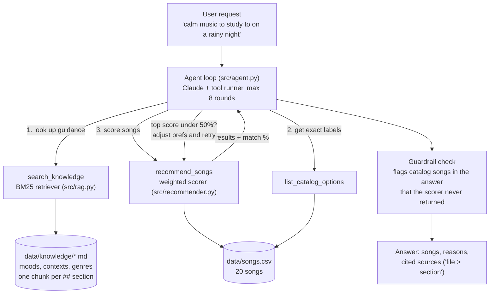

# 🎵 VibeFinder Agent: A Music Recommender with RAG and Tool Use

## Original Project (Modules 1-3)

This project extends my **Music Recommender Simulation** (model name **VibeFinder 2.0**). The original was a content-based recommender. It loaded a 20-song catalog from `data/songs.csv` and compared each song's genre, mood, energy, valence, acousticness and danceability to a user's taste profile. It used a hand-weighted scoring rule, ranked every song, and returned the top K with a plain-language list of reasons for each score. It worked well when the user's labels matched the catalog, but you had to hand it exact values like `mood="happy"`. It could not understand a request like "something calm for a rainy night."

## Title and Summary

**VibeFinder Agent** lets you ask for music in plain English. It then finds songs with the original scoring engine and explains the picks. An LLM agent (Claude) sits on top of the scorer and has three tools:

1. **`search_knowledge`** retrieves guidance from a small markdown knowledge base (RAG).
2. **`list_catalog_options`** shows which genre and mood labels really exist.
3. **`recommend_songs`** runs the original weighted scorer.

Claude translates a fuzzy request into catalog labels and numbers, scores the songs, checks whether the best match is any good, retries if it isn't, and answers with reasons and sources.

**Why it matters:** LLMs are good at understanding people but bad at staying inside a fixed catalog. A deterministic scorer stays inside the catalog but can't understand free text. Combining them means the language model handles interpretation and the scorer handles ranking. Every recommendation can be traced to a score and a source, and the system flags it when the answer names a song the scorer never returned.

---

## Architecture Overview



- **Scorer (`src/recommender.py`)** is the source of truth for ranking. Mood match is worth 2.0, genre match 1.0, and closeness on energy (2.0), valence (1.5), acousticness (1.0) and danceability (0.5). Only features the user actually asked for count. Each score comes with its reasons. The same code also handles the numeric `TopSongs.csv`.
- **Retriever (`src/rag.py`)** splits every markdown file in `data/knowledge/` into one chunk per `##` section and ranks chunks with BM25. It is pure Python, with no embeddings and no extra service. Each result carries a citation like `listening_contexts.md > Studying and deep work`.
- **Agent (`src/agent.py`)** uses the Anthropic SDK tool runner. The system prompt tells Claude to retrieve, map to real labels, score, check match quality, retry when the best match is under 50% of the maximum, and cite sources.
- **Guardrails:** the iteration cap (8 rounds), the "never invent songs" instruction, and the post-hoc check `ungrounded_titles()`, which warns when the answer mentions a catalog song the scorer didn't return.
- **Original CLI (`src/main.py`)** still runs the scorer with no LLM and no API key.

Earlier design diagrams are in [digrams/](digrams/).

---

## Setup Instructions

1. **Clone and enter the project**
   ```bash
   cd applied-ai-system-project
   ```
2. **Create a virtual environment (recommended)**
   ```bash
   python -m venv .venv
   source .venv/bin/activate        # Mac or Linux
   .venv\Scripts\activate           # Windows
   ```
3. **Install dependencies**
   ```bash
   pip install -r requirements.txt
   ```
4. **Run the original scorer (no API key needed)**
   ```bash
   python -m src.main
   ```
5. **Run the agent (needs an Anthropic API key)**
   ```bash
   export ANTHROPIC_API_KEY=your-key-here
   python -m src.agent "something calm to study to on a rainy night" --trace
   ```
   `--trace` prints every tool call the agent made. `--csv path/to/file.csv` swaps the catalog.
6. **Run the tests (no API key needed)**
   ```bash
   pytest
   ```

**Teaching it something new:** add a `## Heading` section to any file in `data/knowledge/`. It is indexed automatically the next time the agent runs.

---

## Sample Interactions

Examples 1-3 below are real output from this repository, run without an API key. Example 4 shows the agent's flow. I had no API key in the environment when writing this README, so Example 4 is the expected behavior from the code and system prompt, not a captured run. Run the command in step 5 to see live output.

### 1. Original scorer (`python -m src.main`)

Input profile: `genre=pop, mood=happy, energy=0.8`

```
============================================================
                    TOP RECOMMENDATIONS
         Profile: genre=pop, mood=happy, energy=0.8
============================================================

#1  Sunrise City  by Neon Echo
    genre=pop / mood=happy
    Score: 4.96 / 5.0  [####################]
    Reasons:
      - mood match (+2.0)
      - genre match (+1.0)
      - energy close (+1.96)

#2  Rooftop Lights  by Indigo Parade
    genre=indie pop / mood=happy
    Score: 3.92 / 5.0  [################----]
    Reasons:
      - mood match (+2.0)
      - energy close (+1.92)

#3  Gym Hero  by Max Pulse
    genre=pop / mood=intense
    Score: 2.74 / 5.0  [###########---------]
```

The maximum is 5.0 because only the three features the user supplied count toward it.

### 2. RAG tool: `search_knowledge("studying late at night", top_k=2)`

```
[listening_contexts.md > Late-night driving]
Night drives suit mid energy (0.5-0.7), a steady 100-120 BPM pulse and a "moody" or "dark" feel. ...

[listening_contexts.md > Studying and deep work]
Focus music should be low in energy (about 0.3-0.5), mostly instrumental or lyric-light, and steady in
tempo (70-95 BPM). Lofi and ambient fit best; the moods "focused" and "chill" are the closest catalog
labels. Avoid high-valence, high-energy pop, ...
```

### 3. Scorer tool with agent-style preferences, plus a weak match

`recommend_songs(genre="lofi", mood="chill", energy=0.35, acousticness=0.8, k=3)` has a maximum score of 6.0:

| Song | Genre / mood | Score | Match | Reasons |
|---|---|---|---|---|
| Library Rain | lofi / chill | 5.94 | 99% | mood, genre, energy +2.00, acousticness +0.94 |
| Midnight Coding | lofi / chill | 5.77 | 96% | mood, genre, energy +1.86, acousticness +0.91 |
| Spacewalk Thoughts | ambient / chill | 4.74 | 79% | mood, energy +1.86, acousticness +0.88 |

`recommend_songs(genre="k-pop", mood="euphoric", k=3)` has a maximum score of 3.0. The best result is Pulse Garden at 2.0 (67%) on a mood match alone. The other results score 0.0 with "no matching features". The best match (67%) clears the 50% retry threshold, so the retry rule would not fire here even though the other two results are padding. That is a gap in the guardrail (see Reliability and guardrail results below).

### 4. Agent flow (expected behavior, not a captured run)

Request: `"something calm to study to on a rainy night"`

```
--- agent trace ---
1. search_knowledge({"query": "studying calm rainy night", "top_k": 3})
2. list_catalog_options({})
3. recommend_songs({"genre": "lofi", "mood": "chill", "energy": 0.35, "acousticness": 0.75, "k": 5})
```

The answer is a short list. Each song gets the reason it fits (taken from the score reasons) and the sources used, for example `listening_contexts.md > Studying and deep work`. If the top match were under 50%, there would be a fourth call with adjusted preferences. If nothing fit, the agent would say so.

---

## Portfolio Artifact

- **GitHub:** https://github.com/sehajvarma08-svg/applied-ai-system-project

**What this project says about me as an AI engineer:** I treat an LLM as one component in a system, not as the system. I took a deterministic recommender I already trusted, gave Claude a small set of tools around it, and kept ranking in code so every answer traces back to a score and a source. I add guardrails (loop cap, input validation, a hallucination check, "no relevant guidance" fallbacks) and test them without needing the model. I also report limits plainly: this README says which results are real captured output, which are not, and where a guardrail has a gap.

---

## Reproducible Execution Evidence

Everything in this section was produced by running the commands below on this repo. Full raw logs are committed in [logs/](logs/):

| Log | Produced by |
|---|---|
| [logs/scorer_run.txt](logs/scorer_run.txt) | `python -m src.main > logs/scorer_run.txt` |
| [logs/guardrail_demo.txt](logs/guardrail_demo.txt) | `python scripts_demo.py > logs/guardrail_demo.txt` |
| [logs/pytest.txt](logs/pytest.txt) | `python -m pytest -q > logs/pytest.txt` |

None of these need an API key. The live agent (`python -m src.agent ...`) does, and I did **not** capture a live run, so no agent output is shown as real.

### Sample commands

```bash
python -m src.main                       # original scorer, example profile
python scripts_demo.py                   # tools + guardrail checks (see below)
python -m pytest -q                      # 57 tests
python -m src.agent "something calm to study to on a rainy night" --trace   # needs ANTHROPIC_API_KEY
```

### Example inputs and outputs

| Input | Output (from logs) |
|---|---|
| `search_knowledge("studying late at night", top_k=2)` | Two cited chunks: `listening_contexts.md > Late-night driving` and `listening_contexts.md > Studying and deep work` |
| `list_catalog_options()` | 17 genres, 16 moods, `song_count: 20` |
| `recommend_songs(genre="lofi", mood="chill", energy=0.35, acousticness=0.8, k=3)` | Library Rain 99%, Midnight Coding 96%, Spacewalk Thoughts 79% |
| `recommend_songs(genre="k-pop", mood="euphoric", k=3)` | Pulse Garden 67%, Carnaval Nights 0%, Coffee Shop Stories 0% |
| `python -m src.main` (pop / happy / energy 0.8) | Sunrise City 4.96/5.0, Rooftop Lights 3.92, Gym Hero 2.74 (see Sample Interactions above) |

### Reliability and guardrail results

| # | Guardrail / check | Input | Result | Status |
|---|---|---|---|---|
| 1 | Unit and integration tests | `pytest -q` | `57 passed in 1.66s` | Pass |
| 2 | Retrieval fallback | `search_knowledge("zzqx plorf wibble")` | `No relevant guidance found.` (no made-up context) | Pass |
| 3 | Empty-input check | `recommend_songs()` with no preferences | `Error: give at least one preference.` | Pass |
| 4 | Output size clamp | `recommend_songs(genre="pop", k=999)` | 10 results (cap) | Pass |
| 5 | Hallucination check, grounded answer | Answer names only a returned song | `[]` (no warning) | Pass |
| 6 | Hallucination check, ungrounded answer | Answer names "Gym Hero", which the scorer never returned | `['Gym Hero']` flagged | Pass |
| 7 | Loop cap | `MAX_ITERATIONS` | `8`, passed to the SDK tool runner as `max_iterations` (constant checked; a live runaway was not tested) | Config only |
| 8 | Weak-match retry rule (best match under 50%) | `k-pop` / `euphoric` | Best match is 67%, so the rule does not fire even though 2 of 3 results are 0% | **Gap** |

**Summary:** 6 of 8 checks passed in a real run, 1 is configuration only (not exercised live), and 1 is a known gap. Check 8 is a real limitation: the retry rule looks only at the top result, so a single weak-but-passing match hides an otherwise empty list. A fix would be to also require several results above 0%. Not done yet.

**Not verified:** live Claude behavior (tool order, retry decisions, answer quality). The agent test uses a mocked client.

---

## Design Decisions

- **Keep the scorer as the source of truth.** The LLM never ranks songs itself. It only picks inputs for the scorer and explains the output. That keeps recommendations explainable, deterministic and limited to the catalog. The trade-off is that the agent can only be as good as the scorer's hand-picked weights.
- **BM25 instead of embeddings.** The knowledge base is three small files, and BM25 is pure Python, free and easy to debug. The trade-off is that it only matches keywords: "wind down" will not find a section that only says "relax". I partly covered this by adding a "near-synonyms" section to the knowledge base.
- **One chunk per `##` section.** Chunks stay small and every result has a clean citation. Anything that isn't under a `##` heading is never indexed.
- **Tools as plain Python methods (`MusicTools`).** The SDK wrappers are thin, so the tools can be tested without calling the API. This is why the tests need no key.
- **Agent loop guardrails.** There is a hard cap of 8 tool rounds and a 50% match threshold that triggers a retry. The threshold is a judgment call: it makes the agent retry on weak results, but it costs extra API calls and may also retry results that were fine.
- **Post-hoc title check instead of blocking.** `ungrounded_titles()` only warns. It uses substring matching, so a song titled with a common word could trigger a false warning, and a paraphrased title could slip through.
- **Small, fixed catalog.** 20 songs keep everything easy to inspect, but there are only one or two songs per genre, so many requests have no great answer.

---

## Testing Summary

`pytest` runs **57 tests, all passing**, in about a second. None of them call the API.

- **Scorer and loader (`tests/test_recommender.py`):** scoring, ranking, tie-breaking, CSV header typos, numeric scaling for `TopSongs.csv`, and the OOP `Recommender` API.
- **RAG and agent (`tests/test_rag_agent.py`):** chunk splitting, tokenizing, retrieval finding the right section for sample queries, gibberish returning nothing, citations in tool output, catalog labels, the scorer tool recording titles, rejecting an empty preference set, tool schema checks, the invented-title detector, and a full `run_agent` run with a mocked client.

**What worked**
- Retrieval reliably finds the right section for natural queries like studying or working out.
- Match percentage is a useful signal. It turns "is this a good answer?" into a number the agent can act on.
- Testing the tools separately from the LLM made bugs easy to localize.

**What didn't, or is untested**
- The agent has not been tested live in this repo. Its tests use a mocked client, so real model behavior (tool order, whether it retries, answer quality) still needs checking by running it.
- The max score depends on which features the user supplies, so "4.96 / 5.0" and "5.94 / 6.0" are not comparable across requests. An early version of this README assumed a fixed 8.0 maximum, which was wrong after the scorer changed.
- Keyword retrieval misses paraphrases, and exact-string mood and genre matching still treats "indie" and "indie pop" as unrelated.

**What I learned:** an AI layer is only as trustworthy as the checks around it. The most useful pieces were not the LLM calls but the small deterministic parts: a score the agent could read, citations, a loop cap, and a title check.

---

## Reflection

Adding an LLM to a working system taught me that the hard part is deciding what the model should *not* do. Letting Claude invent or rank songs would have been easy and would have thrown away the explainability the original project had. Giving it tools and keeping the ranking in code made the system more flexible and kept it accountable. Building the retrieval layer also showed me that "AI" doesn't always mean a neural network: BM25 over a few markdown files solved the problem and was easy to inspect.

The biases from the original project are still here: hand-picked weights, heavy mood and genre weighting, and a tiny catalog. The agent hides them behind friendlier language, which makes them easier to miss. Writing about the weak-match case, and having the system admit when it has no good answer, was the most useful problem-solving habit I took from this.

My graded responsible-AI reflection (how I collaborated with AI, a suggestion I accepted and one I rejected or revised, and the system's limitations) is in the **[Model Card](digrams/model_card.md)**.

---

## Project Structure

```
data/songs.csv            20-song catalog (genre, mood, audio features)
data/TopSongs.csv         larger numeric dataset (year, danceability, mood, ...)
data/knowledge/           markdown knowledge base for RAG
src/recommender.py        weighted scorer + OOP Recommender
src/rag.py                chunking + BM25 retriever
src/agent.py              Claude agent, tools, guardrail check
src/main.py               original CLI (no API key needed)
tests/                    57 tests, no API calls
scripts_demo.py           reproducible tool + guardrail demo (no API key)
logs/                     captured output: scorer_run, guardrail_demo, pytest
digrams/                  data-flow diagram, AI interaction notes, model card
```
