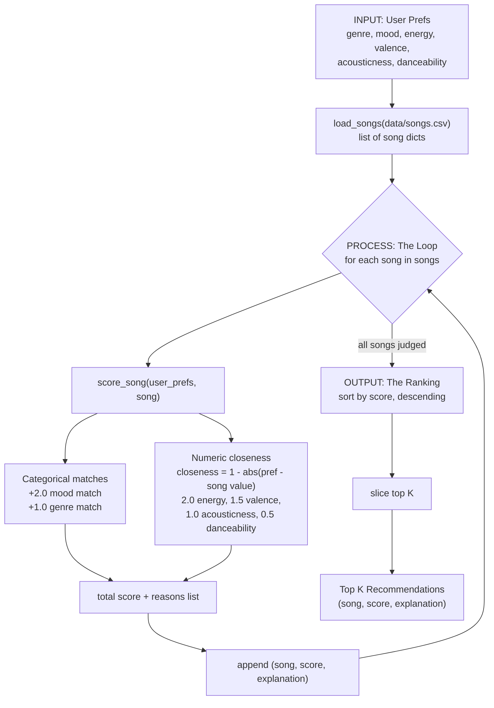

# Data Flow: Music Recommender

A content-based recommender in three stages: **Input → Process → Output**.

## Workflow



## Stages

### 1. Input: User Prefs
A dict (or `UserProfile`) describing the taste to match, for example:

```python
user_prefs = {
    "genre": "pop", "mood": "happy",
    "energy": 0.8, "valence": 0.8,
    "acousticness": 0.2, "danceability": 0.75,
}
```

### 2. Process: The Loop
`recommend_songs` visits **every** row of the CSV once and calls `score_song`.

| Component | Rule | Weight (max points) |
|---|---|---|
| Mood | 1 if equal, else 0 | 2.0 |
| Genre | 1 if equal, else 0 | 1.0 |
| Energy | `1 - abs(pref - value)` | 2.0 |
| Valence | `1 - abs(pref - value)` | 1.5 |
| Acousticness | `1 - abs(pref - value)` | 1.0 |
| Danceability | `1 - abs(pref - value)` | 0.5 |

Maximum possible score: **8.0**. `tempo_bpm` is left out (it's correlated with energy and on a different scale).

`score_song` returns `(score, reasons)`, e.g. `(7.1, ["mood match (+2.0)", "energy close (+1.8)"])`.

### 3. Output: The Ranking
1. Sort all scored songs by score, highest first.
2. Keep the first `k` (default 5).
3. Return `(song_dict, score, explanation)` for each, where the explanation is the joined reasons.

## Mapping to `src/recommender.py`

| Stage | Function |
|---|---|
| Load data | `load_songs(csv_path)` |
| Score one song | `score_song(user_prefs, song)` |
| Loop + rank + top K | `recommend_songs(user_prefs, songs, k)` |
| OOP wrapper | `Recommender.recommend` / `explain_recommendation` |
